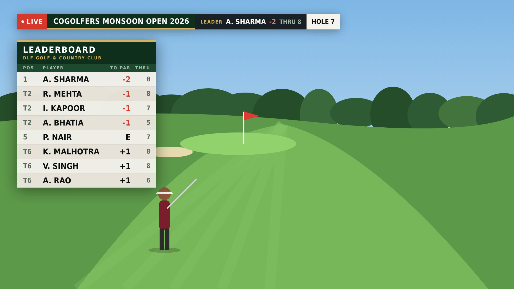
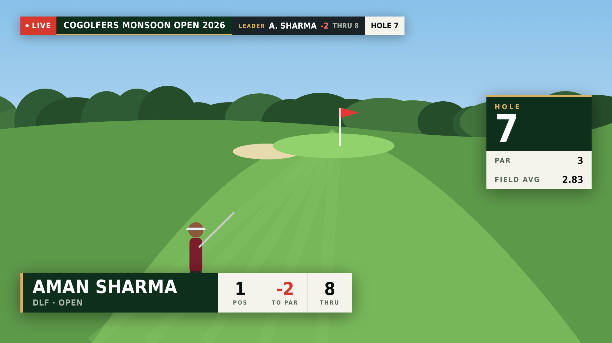
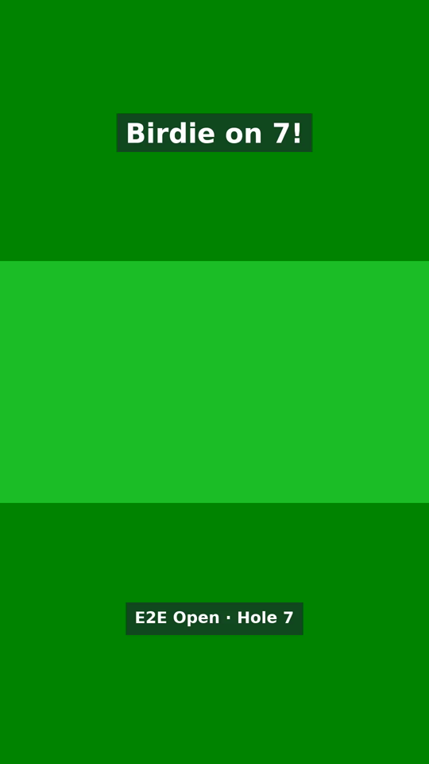
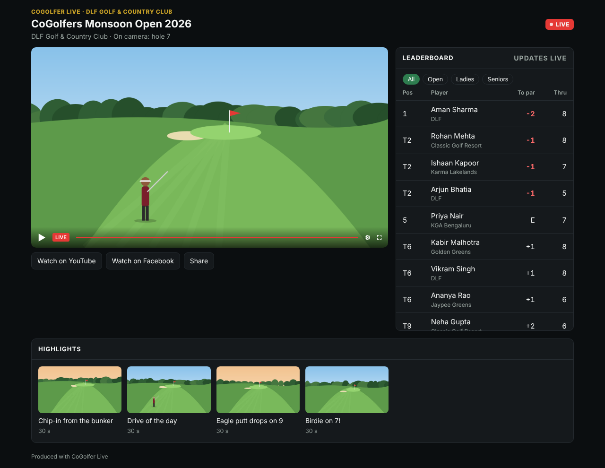

# Testing

## Automated

| Suite | Command | Covers | Result in this build |
|---|---|---|---|
| Server | `cd server && TEST_DATABASE_URL=postgres://… npm test` | sign-up/login/join, org roles and capabilities, join codes + QR, tournaments and mode changes, camera/commentator registry, MediaMTX auth hook rules (incl. programme ingest), scoring + leaderboard (ties, categories), graphics state + SSE, audio, clips + signed links, YouTube OAuth/broadcast (fake Google), Facebook connect + live videos (fake Graph API), Instagram key sealing, relays (start, live, retry alone, stop), public API (CORS, hidden tournaments/clips, embed policy), billing (camera limit and purchase, live-minute meter, 10/2-minute warnings, grace and auto-end, top-up during grace, suspension, per-club pricing), Cashfree (checkout, return page, webhook signature, amount check, credited once; fake gateway), admin API and access, viewer comments (name tokens, slow mode, links, abuse masking, YouTube chat paging and quota stop, Facebook comments, moderation rights, block, pin, on-air question), cloud engine lifecycle, WebSocket switching, tally, auto-fallback | **74/74 pass** |
| Agent (fake OBS) | `cd agent && npm test` | scene sync incl. CG Layers, Browser Source fallback, preview/take/cut, replay play + auto-return, audio (levels, mutes, delay, ducking filter), cloud canvas/encoder, stream destination (server SRT ingest or `.env` key), meters, error surfacing | **15/15 pass** |
| Agent (real OBS) | `OBS_TEST_URL=ws://127.0.0.1:4455 OBS_TEST_PASSWORD=… node --import tsx --test test/obs-real.test.ts` | the same controller against OBS Studio 30 (headless, Xvfb): scenes, switching, replay of an HTTP clip, audio filters, fallback | **6/6 pass** |
| Pipeline (e2e) | `cd agent && MEDIAMTX_BIN=… DATABASE_URL=…/cg_live_e2e npm run e2e` | everything together, below | **33/33 pass** |
| Mobile | `cd mobile && flutter test` | models vs server JSON (incl. platforms, Facebook Pages, public flags), join-link/QR parsing, offline score queue (dead spot, restart, ordering, rejection), API flows (sign-up, join, clips, graphics, audio), login/sign-up validation, home by role, level meter | **not run here** (no Flutter SDK reachable); syntax-checked |

### Pipeline run (real MediaMTX, server, headless OBS 30 started by the cloud-engine script, FFmpeg "phones", fake Google/Meta APIs, fake RTMP ingests for YouTube, Facebook and Instagram)

The output steps check the *actual video each platform receives* by decoding frames: each camera is a different colour, so a cut is only "passed" if the colour on the platform changes. OBS sends one SRT stream to the server; the server's relays feed the three platforms.

```
✔ an organiser signs up: account + club in one step
✔ owner adds a director by email
✔ director creates a cloud-production tournament with course and players
✔ CoGolfers admin (/admin) sets pricing and gives the club credits
✔ QR join codes for camera, scorer and commentator volunteers
✔ three volunteers join by code and register cameras: 2 free, the 3rd after buying an extra camera
✔ all three feeds go live in the control room
✔ owner connects YouTube once (OAuth); director creates the broadcast
✔ owner connects the club’s Facebook Page; director turns on Facebook and pastes the Instagram key
✔ director starts the cloud engine: real OBS boots headless and the agent connects
✔ preview Hole 7, TAKE: OBS confirms the programme
✔ Go live: OBS sends ONE stream (SRT) to the server, which relays it to YouTube, Facebook and Instagram   (all live 8.7 s after OBS)
✔ live minutes are charged from the club wallet while on air (1 credit/min)
✔ viewer comments: watch page, YouTube and Facebook in one feed; director puts a question on air
✔ YouTube output shows Hole 7 (green) — the real programme
✔ one-tap CUT to Hole 1: YouTube output turns red
✔ Facebook and Instagram carry the same programme (red); Instagram is 9:16 720x1280; programme not recorded
✔ a volunteer scorer enters scores; leaderboard and graphics feed update
✔ graphics overlay renders (Chromium, 1920x1080) over the live programme
✔ instant replay of Hole 18: OBS plays it (blue), then returns to Hole 1 (red)
✔ one-tap highlight clip: 16:9 and 9:16 (1080x1920) MP4s and a share link
✔ a volunteer commentator joins and sends their mic over WebRTC (WHIP)
✔ audio mixer on real OBS: course muted → only commentary on air; both muted → silence
✔ Hole 1 phone drops on air → automatic fallback scene on the YouTube output
✔ the phone reconnects; director cuts back to it
✔ YouTube status reaches the director
✔ public watch page for the CoGolfers website: API (CORS), live status, leaderboard, clips, embeddable page
✔ end the stream: relays stop, Facebook live video ended; cloud engine stops (OBS exits)
✔ billing after the show: charging stopped; admin sees the club, its minutes and camera purchase
✔ switch log records every action with who did it
33/33 steps passed
```

Frames saved by the run (the red background is the live Hole 1 camera):

| Score bug, leaderboard, hole card | Lower third (auto hole card after a cut) | 9:16 clip frame | Camera join QR |
|---|---|---|---|
|  |  |  |  |

Public watch page (player area is black only because the test machine cannot reach youtube.com) and the Instagram 9:16 output:

| Watch page | Instagram output |
|---|---|
|  |  |

Audio levels measured on the YouTube output: commentary only −23 dB mean; everything muted −91 dB (silence).

Also run by hand: `tools/sim-camera.sh` against a local server + MediaMTX with a dashed join code → camera registered and LIVE at ~2.8 Mbps, H.264 + AAC.

## Device and event plan (do before the first public event)

Devices: one recent Android, one budget Android (9–11), one iPhone, one iPad. Real server, a laptop-mode tournament and a cloud-mode tournament, an unlisted YouTube broadcast.

| # | Check | Pass when |
|---|---|---|
| 1 | `flutter test`, `flutter build appbundle`, `flutter build ipa` | all succeed (fix any compile nits: the Dart code was not compiled here) |
| 2 | Organiser: New club → staff → Connect YouTube → tournament → par-72 + players paste | each step works without the CLI |
| 3 | Volunteers scan the camera/scorer/commentator QR posters from paper and from the director's full-screen QR | each lands in the right screen in < 30 s, no account |
| 4 | Android + iPhone + iPad cameras live in one control room | tiles LIVE in < 3 s with correct names/holes |
| 5 | Switching: tap → TAKE, CUT, switch once in OBS directly | YouTube follows; app follows OBS; phones show tally |
| 6 | Graphics on air (official OBS on the laptop; check the cloud engine's warning) | score bug, leaderboard, hole card on cut, lower third |
| 7 | Replay 10 s, slow-mo, and a clip shared to WhatsApp (9:16) | replays return to live by themselves; clip plays from the link |
| 7b | Go live with YouTube + Facebook + Instagram on; pull the venue network for 20 s | all three show the same cuts; each platform pill recovers on its own; Facebook video saved on the Page after End |
| 7c | Embed the watch page on a CoGolfers website page; open on a phone | player plays, leaderboard updates within ~10 s of a score |
| 8 | Commentary with earphones; Audio panel: ducking on/off, delay | voice on YouTube, course lowers while talking, lip-sync acceptable |
| 9 | Scorer: flight mode for 3 holes, enter scores, back online; also kill and reopen the app offline | all scores arrive, in order, leaderboard right |
| 10 | Network loss on the on-air camera | fallback in ~5 s; phone recovers by itself |
| 11 | Cloud engine: start, 2-hour run, stop; leave one idle | runs; idle one stops after the configured minutes; cost shown matches |
| 12 | Background rules: Android screen off 5 min live; iPhone home button | Android stays live; iPhone shows PAUSED and recovers |

Record: glass-to-glass latency, battery per hour per platform, phone temperature after 60 min in sun, laptop download rate with all cameras, cloud engine CPU at 1080p.
